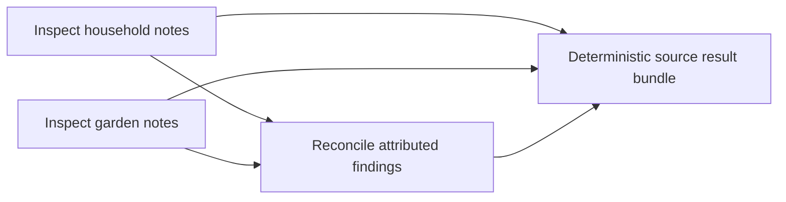

# Phase 8 — Scheduler and Workers

2026-10-18 independent scoped extension: the user authorized an optional
[InstaBox discovery experiment](../research/instabox-discovery.md) on
`feat/instabox-discovery`. It adds metadata inspection and separately granted
bounded standalone CLI exec outside the worker/runtime tool path. Scheduler grants,
accepted ADRs, completion and acceptance disposition below remain unchanged; no
cloud workers, runtime/model remote tools or Phase 9 transition. The completion
review linked from the investigation records the final CLI scope and validation.

Date: 2026-10-16
Authorization: Planning and implementation explicitly approved by the maintainer
Implementation: P8-01–05 Done; solo review recommends close with explicit limitations; maintainer acceptance pending
Phase 7 disposition: PR #15 merged; closure with limitations recommended, no new
administrative closure acceptance inferred from planning or merge
Planning source: `395af2c3` in the existing `feat/context-meter-routing-comparisons`
checkout; PR #15 merge verified as `16d755c4` on main.
Implementation handoff: new branch `feat/task-scheduler-workers` directly from freshly
fetched `origin/main` at `16d755c4`, same checkout, no worktree. ADRs 0017–0019
accepted 2026-10-16 when maintainer approved implementation in a new thread/branch.

## Goal and smallest useful scenario

Execute independent bounded tasks concurrently, then reconcile their attributed
results through explicit dependencies. Each worker runs Astrid's existing model/tool
loop with its own fresh session. A model call is not a worker, and direct inference
is not delegation to an external coding-agent harness.

Proposed first use: in a synthetic notes folder, task A finds outstanding household
actions and task B finds garden actions. They overlap. Task C depends on both and
produces a cited checklist, retaining uncertainty and each original source result.
A deterministic result bundle remains available even if C fails or its synthesis
is wrong. Use the same mechanism for independent read-only code/test inspections.
This scope does not promise parallel coding edits before Phase 9 isolation.



## Previous-phase review and repository audit

[Readiness review](../reviews/phase-8-readiness.md) evaluates Phase 7's exit criterion,
lessons, debt and source seams. [Latest Phase 7 review](../reviews/phase-7-followups.md)
and [pinned validation](../evaluations/phase-7-followup-validation-2026-10-16.json)
remain the evidence: 218 Rust passed/0 failed/1 ignored, 2 Python passed, fmt/clippy.
Those are prior implementation checks, not new Phase 8 execution results.

| Existing seam | Reuse | Gap this phase must address |
| --- | --- | --- |
| `runtime::run` and owned RunResult | One sequential child execution per task | No DAG, ownership, admission or batch outcome |
| `ModelProvider: Send + Sync`, `ToolExecutor: Send + Sync` | Share a backend/executor safely at the Rust interface | Does not prove auth-lock, filesystem snapshot or provider throughput behavior |
| `PermissionPolicy`, headless handler, tool-time checks | Effective grants and denial before dispatch | No multi-worker prompt broker; writes/shell must stay denied |
| `Cancellation` | One cooperative signal per child | Clones share a signal, so scoped propagation must be explicit |
| Checked ExecutionState/ExecutionEvent | Child lifecycle/sequence remains authoritative | New task/batch state must correlate, not rewrite child events |
| Optional metadata traces | Observed model/tool usage and timing | No batch links; new format and shared quotas need a decision |
| v2 idle sessions | Preserve private provenance and resumed history | Not a running-job checkpoint; no worker-history sharing |
| Context budgets | Per-request byte/estimate admission | No aggregate cost cap; dependency inputs must not vanish silently |

## Accepted consequential decisions — 2026-10-16

Maintainer explicitly approved ADRs 0017–0019 and implementation. The options and
recommendations below retain their planning rationale; acceptance is recorded in
each ADR, not inferred from this document.

| Decision | Context/options | Recommendation and consequences | Decision question / gate |
| --- | --- | --- | --- |
| [ADR 0017](../adr/0017-bounded-task-dag.md) | Sequential runs miss the exit criterion; durable jobs/retries add recovery contracts | Static in-process DAG, exclusive one-attempt ownership, all-required dependencies, continue unrelated work, scoped cancellation. Active work is not durable. | Accepted; required for P8-01 |
| [ADR 0018](../adr/0018-worker-authority-and-results.md) | Shared writable state and parent/private history are unsafe; isolation/broker expands scope | Read-only grant intersection; committed bounded visible text only on declared edges; preserve original results and keep synthesis unverified. No concurrent writes. | Accepted; required for P8-01 |
| [ADR 0019](../adr/0019-batch-events-and-traces.md) | A stalled external stream can hold children open; existing trace schemas lack batch identity | Separate explicitly fallible live projection, bounded returned lifecycle log, optional metadata-only batch trace family under shared quotas. Existing run streams unchanged. | Accepted; required before public batch API/recording |

Acceptance of ADRs and authorization to implement Phase 8 are now explicit.
Phase 7 was reviewed and closure with limitations recommended; no separate
administrative acceptance is invented. The maintainer’s explicit implementation
transition supersedes the earlier pending-authorization gate.

## Proposed state, ownership and dependency contract

A Batch contains the caller's immutable task graph and selected canonical workspace.
TaskSpec has an invocation-local key, instruction, dependency keys, requested grant,
existing model/routing/context configuration and call/time limits. Typed BatchId,
TaskId and WorkerId identify runtime entities; user labels are not security identity.
Do not introduce leases, AttemptId, distributed principals or a new crate without a
concrete requirement. Initial tasks have one attempt and cannot spawn more work.

State transitions, serially owned by the coordinator:

| From | Trigger | To / invariant |
| --- | --- | --- |
| Pending | All dependencies published accepted completed results | Ready |
| Pending or Ready | Required dependency failed/cancelled/skipped | Skipped with causal dependency IDs; no child run invented |
| Ready | A free slot is assigned once | Running, one WorkerId; child RunId linked when allocated |
| Pending or Ready | Scoped cancellation accepted | Cancelled; never dispatched |
| Running | Task/parent cancellation or deadline | Cancelling; signal child, retain ownership until joined |
| Running or Cancelling | Actual child result joined and bounded output accepted | Completed/Failed/Cancelled according to observed facts |
| Any terminal state | Duplicate completion/cancel attempt | Reject conflicting transition; idempotent cancellation changes nothing |

Independent tasks become ready on admission. Stable manifest order breaks readiness
ties; dependency payload order is declared edge order, not completion order. Reject
cycles, duplicate keys/edges, self-edges, unknown inputs, unsupported routes/grants
and oversize graphs before any authentication or inference. Snapshot the validated
manifest bytes once; subsequent changes to its file do not alter the running graph.

A task is execution-complete only when its child completed and its bounded visible
result was accepted for publication. A child RunCompleted followed by publication
failure stays RunCompleted in child evidence; task publication failed. Model-call
ceilings, provider/config failures, panic/loss and transfer limits cannot become
successful dependency input. Descendants skip; independent branches continue.
There is no retry or fallback policy to guess.

Overall Failed takes precedence if any task/publication failed or required work
was skipped due to failure. Otherwise cancellation accepted before terminal commit
produces Cancelled, including task-only cancellation; Completed requires all tasks
completed. Preserve successful sibling results and cancellation acknowledgement even
when the overall outcome fails. These are execution outcomes, not quality scores.

## Authority, inputs and reconciliation

The invoking local user grants the selected workspace and capability ceiling.
Intersect parent grant, task request and hard read-only ceiling with Deny > Ask >
Allow. Write/edit and shell never execute, including under an unbound parent.
No worker can widen authority through text, repository config or a dependency.
Ask without a broker denies under ADR 0004. There is no shared stdin/approval queue.
A denied tool result is visible to that worker; it is not proof the task succeeded.

Each task gets a fresh session and cancellation handle. Only explicit TaskInput
is rendered: task instruction plus attributed bounded committed visible final text
from declared dependencies. Preserve source TaskId/RunId, outcomes, byte lengths
and digests in the in-memory input/result records. Private continuation, provisional
text, executable tool calls, parent messages and sibling histories are excluded.
This transfer is new delegated-task input, not replay of a predecessor’s conversation;
ADR 0015’s same-run visible-history handoff remains a separate contract.
Digest matching proves transfer identity, not factual accuracy. Mandatory predecessor
input cannot silently disappear under context compaction; admission failure is explicit.

Return a deterministic ordered bundle of original visible results, failed/skipped
statuses and causal IDs. A caller-declared synthesis node is a separate unverified
interpretation, never a replacement for source results. Contradictions retain both
sources; absence of a model-generated conflict warning proves nothing. No automatic
patch merging, filesystem output artifact, session append or result persistence.

All workers read the selected live folder, not a frozen filesystem snapshot. External
changes remain possible. Child workspace reports record observations without claiming
which worker caused an outside mutation. Trusted local-account limitations remain.

## Cancellation, cleanup and bounds

Parent cancellation first stops admission, then signals active children and joins
before releasing ownership. Task-only cancellation never flips the parent's or a
sibling's token. Completed results remain committed; no rollback. Pre-commit races
are resolved at the serialized transition boundary, not by comparing wall clocks.
Task/batch deadlines request cancellation with a distinct deadline reason. A child
may return RunCancelled while its task reports deadline failure; retain both facts.

Internal child event collectors must continue draining independently of external
rendering. The proposed new batch projection detaches on saturation with explicit
delivery status and retains its bounded lifecycle log in BatchResult. It does not
change existing run-channel lossless/backpressure semantics. Separate metadata
recording can also fail without changing execution outcomes.

Proposed initial local limits (not new security or billing guarantees):

| Resource | Default / bound | Failure |
| --- | --- | --- |
| Graph | 32 tasks, 128 edges; 1 MiB manifest | Reject before dispatch |
| Concurrent workers | 2; hard maximum 8 | Reject invalid limit; never over-admit |
| Model calls | 8 per task; batch reserved sum at most 64 by default | Validate sum before dispatch; no borrowing or extra synthesis calls |
| Rendered task input / transferred final text | 64 KiB each | Explicit input/publication failure; no silent truncation |
| Task / batch deadline | 120 s / 300 s | Cancel with deadline reason; cleanup duration separately observed |
| Lifecycle log and messages | Derived finite maximum from graph/state transitions; bounded channels | Explicit invariant/delivery diagnostic; no unbounded token log |
| Context / provider response | Existing per-run budgets and adapter bounds | Preserve existing preflight/completion rules |
| Trace bytes/files/queue/finalization | Accepted recorder ceilings, shared across trace families | Incomplete/unavailable metadata; never false complete or automatic deletion |

Call reservations are conservative: 32 tasks at the default 8 calls do not fit the
default 64-call batch budget. The caller must narrow per-task ceilings or explicitly
raise a validated batch ceiling. Deadlines include auth/tool waiting; cleanup may
outlast them. No precise token/cost budget or bounded remote billing is claimed.

Inspect and test the blocking auth lock before concurrent claims. Reuse the existing
auth/synthetic fixtures, including simultaneous refresh and cancellation while a
real lock is held. If dropping the async wait leaves an owned lock-acquisition task,
fix it without removing cross-process exclusion or account checks. Native blocking
reads remain cooperative. Do not promise universal hard shutdown of arbitrary code.

## Events, tracing and CLI proposal

Batch events expose admission, dependency readiness, exclusive assignment, child IDs,
cancellation, publication and terminal outcomes with one batch sequence. Per-child
ExecutionEvent sequences and model/effort/replay reasons remain unchanged. Private
continuation never enters either event surface. BatchResult includes typed outcomes,
original visible result envelopes, bounded lifecycle log and delivery/recording status.

Implemented CLI (P8-05; [guide](../scheduler.md)):

```sh
astrid batch run ./tasks.json --folder ./synthetic-notes --concurrency 2
astrid batch trace <batch-id>
```

The bounded manifest names three tasks with `depends_on` edges A/B→C and existing
model settings. Exact spelling/layout is a reversible CLI choice during its ticket;
its graph, authority and data contracts are not. No repository auto-discovery or
model-generated graph submission. Ctrl-C cancels the batch; a headless control API
can cancel one identified task. Tag progress/results by task; reuse context estimate
labels per worker and never present summed percentages as one model window. Preserve
bare `astrid`, normal `run`, idle v2 and existing `trace` interfaces.

Optional new metadata batch traces link existing child run traces and record
allowlisted generated IDs/topology, policy actions, lifecycle, numeric counts and
coverage. Omit task labels/text, paths, dependency text/digests, credentials and
private state. New trace family/schema, shared total quotas, no v2 snapshot migration,
no content recording or durable job queue. Missing child traces/usage remain unknown;
aggregate wall time is observed directly and model/token totals include coverage.

## Tickets

P8-01–05 are **Done** with slice/final validation below. P8-00 remains the historical
documentation-only planning ticket. The accepted contracts and explicit implementation
authorization were followed in the requested new thread/branch. Earlier Draft/Ready
statements below describe handoff history and ticket blueprints. Maintainer acceptance
and any successor transition remain separate.

| ID | Observable slice | Dependencies | State |
| --- | --- | --- | --- |
| P8-00 | Previous-phase/source readiness review, decision proposals, bounded plan and invariant matrix | Planning request | Done; documentation validation recorded in CURRENT |
| P8-01 | Two independently owned read-only tasks overlap through a headless batch API; validation/bounds/denial enforced | Phase 7 review recorded; implementation and ADRs 0017–0019 accepted | Done; [224/0/1 validation](../evaluations/phase-8-slice-1.json) |
| P8-02 | Declared dependencies publish only accepted visible inputs; deterministic reconciliation bundle plus dependent synthesis | P8-01, ADR 0018 | Done; [237/0/1 validation](../evaluations/phase-8-slice-2.json) |
| P8-03 | Cancellation, deadlines and branch failures terminate owned work with correct causal outcomes under adversarial timing | P8-01/02; basic cancellation is already required in P8-01 | Done; [237/0/1 validation](../evaluations/phase-8-slice-2.json) |
| P8-04 | Batch lifecycle replay and metadata trace inspection correlate children without content leakage or double counting | P8-01/02, ADR 0019; basic events/delivery required in P8-01 | Done; [246/0/1 validation](../evaluations/phase-8-slice-3.json) |
| P8-05 | CLI graph execution and frozen acceptance evidence; final review with limitations | P8-01–04 | Done; [255/0/1 final validation](../evaluations/phase-8-validation-2026-10-16.json) |

### P8-01 — First complete vertical slice

Problem: only single sequential run entry points exist. Scope: one private scheduler
module in the current crate, static validated input, two slots/tasks with fresh runs,
read-only grants, distinct IDs/tokens, internal event draining and bounded terminal
result. A caller can demonstrate concurrency headlessly without a new UI or service.
Initially reject nonempty dependency graphs explicitly until P8-02 is complete; do
not release a public manifest interface with unimplemented dependency semantics.

Acceptance: both barrier-controlled providers enter before either completes; owner
is unique and slots are reclaimed only after join; invalid config has zero authentication/generation or task-tool
dispatch; denial spies never execute write/edit/shell even under unbound parent. No
shared session/private sentinel and no idle store writes. Basic parent cancellation,
projection saturation and real auth-lock contention pass before calling the slice
complete. Returned observed lifecycle facts match state, without quality claims.

Validation: new deterministic scheduler tests alongside existing runtime/permission/
auth suites. Demonstrate contention first and fix concrete prerequisite failures;
record any changed baseline contract. Review exact source, run locked test/fmt/strict
clippy after the slice, update checkpoint and this plan with actual counts.

### P8-02 — Dependencies and result reconciliation

Problem: overlap alone does not establish a DAG or explicit communication. Scope:
all-required dependency scheduling and TaskInput/TaskResult publication, original
source bundle and an explicitly declared synthesis node. No automatic file changes.

Acceptance: C starts only after A and B publish; reversed completion order preserves
input attribution/order; failed/oversized/uncommitted inputs skip C with causal IDs;
unrelated D still completes. Assert byte/hash identity, no private/undeclared data,
no mandatory-input loss under compaction, contradictions/source results retained
when C disagrees or fails. Native/routed child configuration remains observable.

Validation: adversarial graph and synthetic code/notes fixture tests; no live model
needed for invariants. Locked test/fmt/strict clippy and slice review/checkpoint.

### P8-03 — Failure, cancellation and cleanup

Problem: task cancellation cannot share a root token, and failure must not fabricate
successful dependent work. Scope: complete the state/race matrix, deadline reason
mapping, no retry on panic/loss, join ownership and out-of-order completion handling.

Acceptance: task-only cancel preserves sibling progress; root cancel stops queued
admission and joins active work; failure skips only descendants. Completed work is
never relabelled by late cancellation. Failed cleanup is not masked by Cancelled.
Stalled/closed clients cannot prevent internal drains or owned worker termination;
deadline cancellation is distinct from user request. Unknown run IDs stay absent.

Validation: barriers/notifications with bounded test guards, not sleeps as concurrency
proof; provider/auth/native-read cancellation, saturated channels and panic fixtures.
Required Rust checks and slice review. No hard-kill guarantee beyond existing tools.

### P8-04 — Inspection without content retention

Problem: child traces have no durable batch topology and a live subscriber can detach.
Scope: typed reducer replay, optional separate metadata batch writer/reader and CLI
inspection adapter. Keep existing run schema/readers and idle session v2 unchanged.

Acceptance: lifecycle replay equals final state; child links/coverage are exact;
full/closed stream reports projection incomplete while BatchResult retains complete
bounded lifecycle; privacy sentinels absent on disk. Shared quota/file/lock tests
cover simultaneous writers. Corrupt/truncated/unsupported records report incomplete
or explicit errors. Unknown metrics stay unknown and aggregates do not double count.

Validation: existing trace fixtures plus batch-specific adversarial metadata tests;
locked test/fmt/strict clippy, privacy/source diff review, checkpoint update.

### P8-05 — CLI acceptance and evidence review

Problem: the CLI needs an understandable client for the headless scheduler. Scope:
bounded caller manifest, selected non-Git or Git folder, compact tagged output,
Ctrl-C, batch inspection and final source-preserving report. No dashboard/daemon.

Acceptance: deterministic CLI tests exercise real tools and two overlapping tasks
plus dependent reconciliation, permission denial, failed dependency and interruption.
Ordinary CLI/session/routing behavior remains intact. Freeze tiny notes/code task
rubrics before one bounded live acceptance scenario using existing auth; separately
grade factual/artifact outcomes. Missing model/cost metrics stay unavailable. A live
result is limited protocol/quality evidence, not proof of speedup or scheduler safety.

Validation: full locked tests, fmt, strict all-target clippy, CLI/PTY checks where
appropriate, local links/whitespace/source hashes, frozen mocked and live records,
solo exit review and retrospective. Do not auto-advance Phase 9 or declare acceptance.

## Exit criterion and stop rule

Phase 8 exit requires evidence of two independent tasks actually overlapping,
independent ownership/authority/conversation state, a dependency respecting accepted
results, safe attributed reconciliation, complete cancellation/failure accounting
and inspectable parent/child lifecycle. Every claimed invariant needs a deterministic
failure test; model quality is graded separately. Final review recommends close,
close with limitations or hold. Maintainer acceptance is separate.

Out of scope: concurrent writes/shell, worktrees, auto-merging, dynamic/model-created
graphs, retries, durable leases/jobs, crash recovery, remote workers, new harness
adapters, ML routing, groups, MCP, daemon/desktop/GPUI, local inference and Phalanx.
M02 remains Paused/unaccepted; Phases 5/13 Deferred. The maintainer has now explicitly accepted
the three contracts and authorized implementation in a new thread. Begin P8-01;
validate and update this plan/checkpoint after each slice. No successor advancement.

## Planning validation — 2026-10-16

385 local Markdown file targets resolve against tracked/scoped planning documents;
new-document whitespace and `git diff --check` passed. Three ADR statuses and all
five Draft implementation tickets checked. Source hashes still match the recorded
Phase 7 baseline. No new runtime tests, inference, implementation, staging or commit.
See [CURRENT](../CURRENT.md) for the exact planning checkpoint and pending decisions.

## Implementation handoff — 2026-10-16

Maintainer approved the ADR decision question and instructed new thread/new branch.
Accepted ADRs and naming preference are recorded in AGENTS. Branch
`feat/task-scheduler-workers` starts at `16d755c4`; no worktree. Planning files were
backed up and verified byte-for-byte across the switch before acceptance updates.
No Rust tests or scheduler implementation ran during this handoff; prior 218/0/1
and 2 Python results remain historical baseline evidence. Follow CURRENT for recovery.

## P8-01 implementation evidence — 2026-10-16

Two fresh owned read-only runs overlap at a deterministic barrier. Admission,
call reservations, policy intersection, denial spies, internal drains, projection
detach, root cancellation and lifecycle replay pass. Auth orphan wait reproduced
first, then replaced by cancellable nonblocking exclusive lock attempts.
`cargo test --locked`: 224 passed, 0 failed, 1 ignored; fmt, strict all-target
clippy and whitespace passed. [Pinned slice evidence](../evaluations/phase-8-slice-1.json),
[solo review](../reviews/phase-8.md). No live inference. P8-02 now In progress.

## Dependency and cleanup slice underway — 2026-10-16

P8-02 dependency behavior and P8-03 adversarial verification form the next validated
slice. Basic scoped cancellation/deadline/ownership machinery already belongs to
P8-01; the second slice exercises it against dependencies, failures, panic, held
auth locks and compaction before advancing to recording. Intermediate failure:
a provider-return notification did not establish publication order. The fixture
now releases A only after observing B's committed lifecycle event. A second
parallel-only lock-fixture failure passed in isolation; explicit fixture unlock
and an account guard with explicit unlock address temporarily duplicated fork
descriptors, retaining exclusion across refresh/account validation/save. Full
second-slice checks are pending; no later ticket is marked Done from focused tests.

## P8-02/P8-03 validation — 2026-10-16

Dependency and cleanup slice complete: 237 Rust passed, 0 failed, 1 ignored;
fmt and strict all-target clippy passed. [Pinned evidence](../evaluations/phase-8-slice-2.json).
Sixteen scheduler tests cover DAG ordering, source preservation, bounded publication,
actual compaction, failure chains, task/root cancellation, late races, panic,
deadlines, cleanup precedence and real auth contention. Synthetic simultaneous
refresh passes without paid services. [Solo review](../reviews/phase-8.md) retains
intermediate failures/fixes. P8-04 In progress; no live inference or Phase 9.

## P8-04 validation — 2026-10-16

246 Rust passed, 0 failed, 1 ignored; fmt and strict all-target clippy passed.
[Pinned evidence](../evaluations/phase-8-slice-3.json). New batch metadata family
uses `traces/batch-<BatchId>.jsonl` (flat generated namespace rather than the
proposed subdirectory), so both families use the exact same writer lock and total
byte/file admission. Concurrent file-quota and byte-quota tests pass; contention
uses bounded nonblocking lock retries inside recorder threads. Unknown panic
counts remain unknown. Batch replay/privacy/partial-schema/CLI inspection tests
pass and existing run statistics exclude batch aggregates. P8-05 In progress;
no live inference yet. No schema-1 run or idle-v2 migration.

## P8-05 and final implementation validation — 2026-10-16

P8-01–05 complete in the requested branch/checkout. Final `cargo test --locked`:
**255 passed, 0 failed, 1 ignored**; **2 Python passed**; fmt, strict all-target
clippy and whitespace passed. [Pinned source/commands](../evaluations/phase-8-validation-2026-10-16.json),
[deterministic acceptance](../evaluations/phase-8-mocked-2026-10-16.json),
[user/API guide](../scheduler.md), [solo exit review](../reviews/phase-8.md).

One frozen bounded live notes batch passed separate solo factual grading:
29.000902 s, 6 model calls, 4 tools, all original results and declared transfers
retained; fixture bytes unchanged. [Original live record](../evaluations/phase-8-live-2026-10-16.json).
Batch trace complete; child trace coverage 1 complete/2 unavailable. Whole-batch
usage/cost remain unknown. The pre-diagnostic CLI did not retain missing child
recording causes; no cause is invented and no second live batch was used. A later
first-use directory regression passed. Final CLI now exposes invocation-only writer
diagnostics while metadata remains content-free. Reused nested permission/context
serde is unchanged; new-manifest parsing explicitly rejects unsupported nested
fields. Routed-child model/effort evidence and visible-only dependent transfer pass.

Recommendation: close with explicit limitations; maintainer acceptance pending.
Stop at authorized Phase 8. No Phase 9, worktree, mutation/shell worker, daemon,
desktop or later-phase work. Work remains uncommitted, without broad staging or PR;
recovery snapshots/stash, private v2/continuation and unrelated files retained.

## Publication — 2026-10-16

Maintainer requested a PR. [PR #16](https://github.com/404khai/astrid/pull/16) is open
against main from the requested topic branch; implementation commit `be701c13`.
Only 33 scoped files were staged. All 86 pinned source hashes matched the index;
publication adds no runtime code or new inference. Required exact-source checks
above remain the validation evidence. No merge, phase transition or unrelated
artifacts included; recovery data remains preserved.
